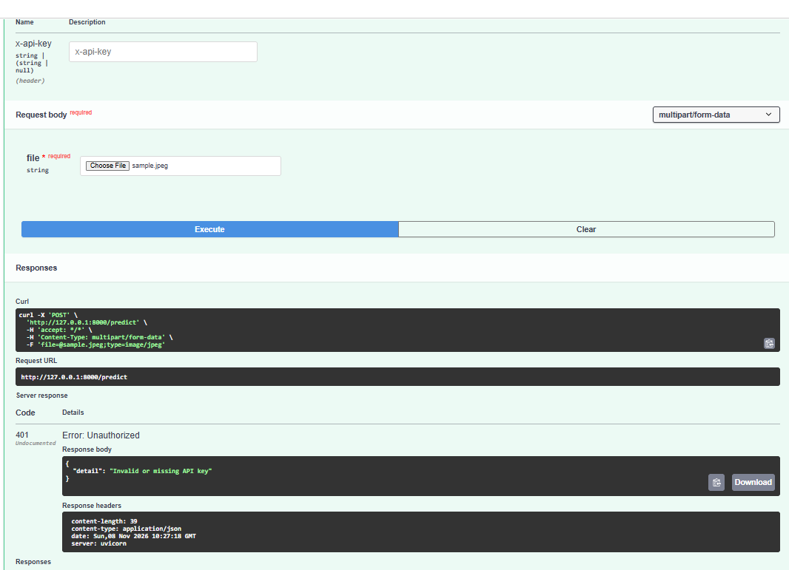

# Applied AI - Project 2: Deep Learning Applications
## Week 8: Deploying the Medical AI API (FastAPI)

**Local API:** `http://127.0.0.1:8000/docs` (FastAPI Swagger UI)

### 1. API Implementation and Usage
I transformed my Week 6 Pneumonia image model and Week 7 text pipeline into a robust FastAPI web service. The API accepts an X-ray image and a clinical note, masks sensitive PII, runs the image through the PyTorch model, extracts urgent terms from the text, and returns a structured JSON case record.

| Endpoint | Method | Description |
| :--- | :--- | :--- |
| `/health` | GET | Confirms the model is loaded and returns the positive class. |
| `/predict` | POST | Accepts an image file (JPEG/PNG) and returns the predicted class, probabilities, and latency. |
| `/analyze` | POST | Accepts an image and a text note. Masks PII, extracts fields, checks for urgent terms, and returns a `REFER` or `ROUTINE` decision. |

**Example API Call (cURL):**
`curl -X POST http://127.0.0.1:8000/analyze -F "file=@sample.jpeg;type=image/jpeg" -F "note=Cough and fever since Monday. Call 0300-1234567."`

### 2. Real-World Troubleshooting: API Key Security (Task A.6)
While testing the optional API Key requirement, I encountered an authentication issue.
*   **The Problem:** I set the `API_KEY` environment variable in the terminal to secure the API, but I forgot to enter it into the `x-api-key` input box in the Swagger UI. This resulted in a `401 Unauthorized` error.
*   **The Fix:** I typed the secret key (`choose-a-long-secret`) into the `x-api-key` box. The API successfully authenticated and returned the `200 OK` response with the prediction.
*   **Takeaway:** This proves the security feature works. Any client calling the API must include the header `x-api-key`, otherwise they are blocked.

### 3. Testing and Benchmarking (Task A.5)

**Pytest Output:**
`8 passed, 1 warning in 10.15s`

**Performance Benchmark:**
The API was benchmarked using 50 image prediction requests. 

**Actual Benchmark Output:**
`N=50  p50=59 ms p95=68 ms max=522 ms`
`Throughput with 1 worker ~ 14.4 requests/s`

**Performance Summary:**

| Metric | Value |
| :--- | :--- |
| **Hardware** | Windows Laptop (AMD Ryzen 5 7430U, 7.7 GB RAM) |
| **p50 Latency** | 59 ms |
| **p95 Latency** | 68 ms |
| **Max Latency** | 522 ms |
| **Throughput** | ~14.4 requests/s (1 worker) |

**Little's Law Calculation:**
*   **Formula:** `Concurrency = Throughput * Latency`
*   At p50 latency of 59 ms (0.059 seconds): Max throughput per worker = 1 / 0.059 = **16.95 requests/second**.
*   Requests per day = 16.95 * 60 * 60 * 24 = **1,464,480 requests per day** (theoretical maximum at 100% utilization).

**Bad Input Test (Manual Swagger UI Check):**
Beyond the automated `pytest` tests, I manually tested the API via the Swagger UI by trying to upload a plain text file (`notes.txt`) to the `/predict` endpoint. The API correctly rejected it and returned a **415 Unsupported Media Type** error. It did not crash, and it did not return a 500 server error. This proves the API's error handling is working correctly and prevents users from sending unreadable files to the image model.

### 4. Check Your Understanding

| Question | Answer |
| :--- | :--- |
| **1. A client uploads a PDF to `/predict`. Which status code should it get, and why not 500?** | It should return **415 Unsupported Media Type**. It is not a 500 because the server is working; the client just provided the wrong input format. |
| **2. Why is the model loaded in `lifespan` rather than inside the endpoint?** | Loading the model inside the endpoint would reload the weights for every request, making the API extremely slow. `lifespan` loads it once on startup. |
| **3. p50 = 40 ms and p95 = 400 ms. What does that tell you, and what would you check?** | The median is fast, but the worst-case is 10x slower. 5% of users wait 0.4s. I would check for memory spikes or the server being blocked by other tasks. |
| **4. 500,000 requests a day, peak 5 times the average, 25 requests per second per worker. How many workers?** | Average: 500,000 / 86,400s = ~5.8 req/s. Peak: 5.8 * 5 = 29 req/s. Workers needed: 29 / 25 = **2 workers**. |
| **5. Why can model inference inside an `async def` endpoint slow down other requests?** | Model inference is a CPU-heavy blocking operation. If run directly in an `async` function, it blocks the main event loop, preventing the server from responding to other requests. |
| **6. How many communication channels does a 4-person team have?** | Formula: `n(n-1)/2`. `4(3)/2 =` **6 channels**. |

---

## Week 7: Text and Multimodal AI (Medical NLP Pipeline)

**Kaggle Notebook Link:** [[WEEK 7 KAGGLE LINK](https://www.kaggle.com/code/mahumjunaid/week-7-text-and-multimodal?scriptVersionId=364555031)]

### Project Overview
This week extends the Week 6 chest X-ray classifier into a **multimodal clinical triage pipeline**. The system integrates image predictions with unstructured text processing (NER, Regex, and OCR) to generate a transparent, privacy-compliant JSON case record.

### 1. Text Classification (SMS Spam)
A comparison of Word vs. Character n-gram models on the SMS Spam Collection dataset:
*   **Word 1-2 grams:** Macro-F1 **0.974** 
*   **Char 2-5 grams:** Macro-F1 **0.982**
*   **Feature Analysis:** Spam messages relied on urgency triggers (`'call'`, `'txt'`, `'free'`), while normal messages used conversational terms (`'my'`, `'me'`). The character model proved more robust against spelling obfuscations (e.g., "priz3") and correctly ignored Roman Urdu text.

### 2. Named Entity Recognition (Medical Domain)
The base spaCy model was evaluated against 10 custom medical sentences (using local Pakistani hospital data). 
*   **Base Model (F1 = 0.857):** The general-purpose model struggled with medical terminology, misclassifying the drug **"Amoxicillin" as a location (GPE)** and **"Karachi" as an organization (ORG)**.
*   **Custom Rules (F1 = 0.667):** Adding `EntityRuler` patterns for local hospitals and drugs highlighted a key lesson in data annotation: the evaluation F1 dropped because the initial "gold standard" was incomplete, not because the model failed. 
*   **Limitations:** The rule-based approach remains fragile for complex terms like "Aga Khan University Hospital", suggesting that a domain-specific model (e.g., BioBERT) is required for production-level medical NLP.

### 3. Regex Fields & OCR
*   **Regex:** Patterns were developed to extract CNICs, mobile numbers, amounts (PKR/Rs), dates, and invoice numbers. **Negative tests** (e.g., ignoring 13-digit order numbers) were implemented to prevent false positives.
*   **OCR:** Using `easyocr` on a synthetic invoice, the raw Character Error Rate (CER) was **0.032**. Context rules (e.g., replacing the letter 'O' with the number '0' inside numbers) successfully reduced the CER to **0.000** on specific test cases.

### 4. Multimodal Case Record
The final pipeline combines the Week 6 image model and the text extraction into a single JSON record.
*   **Privacy:** PII (CNICs and phone numbers) is masked **before** entity extraction. The output shows `[PHONE]` in the `note_masked` field, ensuring no sensitive data leaks into the logs.
*   **Transparency:** The JSON includes `reasons` for the decision (e.g., "image model: P(PNEUMONIA) = 0.99" and "note mentions: fever, breath"). 
*   **Safety:** If the image model predicts low risk but the note mentions "fever" and "breath," the system still flags the case for a `REFER` review. Clinical symptoms are prioritized over a single X-ray, with the final decision always left to a qualified human.

### Week 8 Proposal
For the final project, the pipeline will be deployed using **FastAPI**. The API will accept an image upload and a text note, run the image through the ResNet model, process the text via spaCy and Regex, and return the fused JSON record with all PII masked.

## Week 6: Pneumonia Detection (Medical Imaging)

**Kaggle Notebook Link:** [[ WEEK 6 KAGGLE LINK ](https://www.kaggle.com/code/mahumjunaid/week-6-medical-imaging-pneumonia-detection)]

**Overview:**
This week, I moved from natural scenes to a real-world medical dataset. The goal was to build a complete, defensible computer vision pipeline that handles imbalanced data, patient-level leakage, and identifies model shortcuts using Grad-CAM.

**Dataset:**
*   **Name:** Chest X-Ray Images (Pneumonia)
*   **Source:** [Kaggle - Paul Mooney](https://www.kaggle.com/datasets/paultimothymooney/chest-xray-pneumonia)
*   **Classes:** 2 (NORMAL, PNEUMONIA)
*   **Total Images:** 5,863 (Train: 5,216 | Test: 624 | Val: 16)

**Data Audit & Pipeline:**
*   **Imbalance:** The dataset is heavily imbalanced (ratio 2.89). I handled this using weighted loss (NORMAL: 1.935, PNEUMONIA: 0.674).
*   **Leakage Audit:** Found 62 exact duplicates but 0 near-duplicates between train and test.
*   **Group Split:** Used `StratifiedGroupKFold` to ensure 0 patient overlap between train and validation, preventing data leakage.

**Model & Results:**
*   **Architecture:** ResNet-18 (pretrained). Phase 1 (head only) trained 1,026 parameters. Phase 2 (fine-tuned last block).
*   **Best Epoch:** Selected by Validation Macro-F1 (0.947).
*   **Test Accuracy:** 92.5%
*   **Test Macro-F1:** 0.917
*   **Threshold Tuning:** Tuned on validation for 95% recall (threshold = 0.363). Achieved 99.2% sensitivity and 80.3% specificity on the test set. PPV at 5% realistic prevalence is 20.9%.

**Grad-CAM Finding:**
While the model correctly focused on lung fields for many NORMAL images, the error gallery revealed **shortcut learning**. For some misclassified images, the model looked intensely at the bright white "R" marker or text in the corner, rather than the lungs. The proposed fix is to crop or mask these text regions before training.

### Responsible Domain AI
*   **Who could be harmed, and how?** A child with pneumonia could be sent home without treatment because of a false negative. Alternatively, a healthy patient could be unnecessarily stressed and exposed to radiation if falsely flagged (false positive).
*   **Where was it NOT validated?** The dataset consists of pediatric patients (ages 1-5) from a single hospital (Guangzhou Women and Children’s Medical Center). It has not been validated on adults, other hospitals, different X-ray machines, or the local Pakistani population.
*   **What is the human role?** The model acts as a triage assistant to prioritize a radiologist's queue. It is a screening tool to flag high-risk images; it is never a final diagnosis. A human radiologist must review every flagged image.
*   **What would change your mind?** External validation at a local Pakistani hospital demonstrating that the model maintains a high enough PPV at the local prevalence rate (accounting for local scanner differences and population demographics).

---

## Week 5: Scene Classification with Transfer Learning

**Kaggle Notebook Link:** https://www.kaggle.com/code/mahumjunaid/week-5-transfer-learning

**Overview:**
This project builds a deep learning image classifier to recognize 6 types of natural scenes (buildings, forest, glacier, mountain, sea, street) using the Intel Image Classification dataset. The model uses a pretrained ResNet-18 and explores both feature extraction and fine-tuning.

**Dataset:**
- **Name:** Intel Image Classification (puneet6060)
- **Classes:** 6 (buildings, forest, glacier, mountain, sea, street)
- **Splits:** 11,929 train / 2,105 val / 3,000 test
- **Image Size:** 224 x 224 (Resized from 150x150)

**Model Architecture:**
- **Base Model:** ResNet-18 pretrained on ImageNet
- **Phase 1 (Feature Extraction):** Froze all layers, trained only the new 6-class fully connected head. Trainable parameters: **3,078**.
- **Phase 2 (Fine-Tuning):** Unfroze `layer4` and trained with two different learning rates (1e-4 for pretrained layers, 1e-3 for the new head). Trainable parameters: **8,396,806**.

**Results:**
| Phase | Best Validation Accuracy |
| :--- | :--- |
| Feature Extraction | 91.1% |
| Fine-Tuning | 94.0% |
| **Final Test Accuracy** | **93.2%** |

**Weakest Classes (by Recall):** Mountain (0.903) and Street (0.920)
**Most Confused Pair:** Glacier vs. Mountain (61 mountain images predicted as glacier)

**Most Instructive Error:** 
In the error gallery, the model predicted "street" (confidence 0.91) for an image labeled "buildings". Looking at the image, it shows a building with a very prominent street in front of it. This is a genuinely ambiguous image where the label is technically correct, but the visual features heavily favor the "street" class.

**Next Steps: Week 6 Proposal**
For my own domain in Week 6, I propose applying this same transfer learning pipeline to a **medical imaging dataset** (specifically chest X-rays for pneumonia detection). The candidate dataset is the **"Chest X-Ray Images (Pneumonia)"** dataset from Kaggle. This will test whether ImageNet-pretrained features (edges, textures) transfer effectively to grayscale medical images, which look very different from natural scenes.
